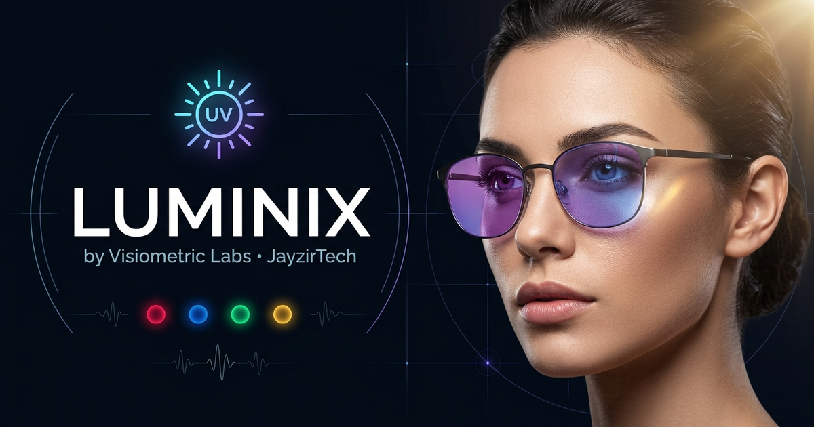

# Luminix™ by Visiometric Labs 🕶️✨

> **Simulador Clínico Interactivo de Lentes Fotosensibles Transitions® y Probador Facial 3D en Mostrador**  
> Desarrollado por **JayzirTech** para **Visiometric Labs**.

<p align="center">
  <a href="README.md"><strong>🇪🇸 Versión en Español</strong></a> • 
  <a href="README_EN.md"><strong>🇺🇸 English Version</strong></a>
</p>

<p align="center">
  <a href="https://visiometric-labs.github.io/transitions-simulator/"></a>
  <a href="https://visiometric-labs.github.io/transitions-simulator/"></a>
  
  
  
</p>

<p align="center">
  
</p>

---

## 🎯 Descripción General

**Luminix** es una plataforma clínica de simulación óptica en primera persona (POV) y probador virtual facial 3D en tiempo real, diseñada específicamente para ópticas, consultorios optométricos y mostradores de atención al paciente.

Permite al paciente experimentar de forma vívida e interactiva la diferencia entre la visión al descubierto (deslumbrada por la radiación solar y la luz artificial) y la protección visual inteligente de las lentes fotosensibles **Transitions®** (*Signature Gen S™*, *XTRActive® Polarized*, *Style Mirrors™* y comparativa pedagógica frente a lentes estándar).

---

## 🔬 Capacidades Clínicas y Tecnológicas Destacadas

### 1. Visión en Primera Persona (POV) con Comparativa de Deslumbramiento
- **Visión al Descubierto (Sin Gafas)**: Motor óptico multicapa calibrado para recrear sobreexposición natural (50,000+ lux), resplandor corneal (*bloom* con `mix-blend-mode: screen`), puntos calientes especulares (*hotspots* con `color-dodge`) y velo solar volumétrico.
- **Visión a Través del Cristal (Transitions®)**: Neutraliza el deslumbramiento cegador, optimiza la luminancia a niveles descansados (0.70 a 0.86), restaura el contraste cromático de los detalles y modula el tintado cinético activo según la radiación UV del entorno.
- **Navegación de Mirada (Gaze POV) con Cinemática Fisiológica**:
  - **Física de Cuello Real**: Simulación biomecánica de rotación de cuello con ángulos Yaw (giro horizontal ~±45°) y Pitch (inclinación vertical ~+36° / -40°) con amortiguación exponencial independiente del framerate (60 a 120+ FPS).
  - **Inercia Táctil (Momentum Fling)**: Al soltar el dedo o ratón, la mirada continúa deslizándose suavemente con deceleración por fricción progresiva.
  - **Control Directo sin Joystick**: Pantalla limpia y despejada para punto de venta; navegación 100% por arrastre directo táctil o ratón.
  - **Mirar hacia Arriba**: Permite mirar por encima de la montura al sol deslumbrante sin filtro.
  - **Mirar al Centro**: El paciente vuelve a cubrir su eje visual con el lente fotosensible, experimentando el confort protector inmediato.
  - **Sincronización Óptica Unificada al Sub-Píxel**: Fondo exterior (`SceneManager`) e interior (`GlassesPOV`) unificados en proyección SVG idéntica (`viewBox="0 0 1920 1080"` con `width="2240" height="1250"` y paneo instantáneo `worldPanX = -gazeX * 120`, `worldPanY = -gazeY * 70`). Cero desfase, cero retraso y perfecta alineación de árboles, senderos y edificios al cruzar el borde de la lente.
  - **Recentrado Inmediato**: Botón flotante dinámico y doble toque/clic para volver al centro.

### 2. Avatar Facial 3D Real (Three.js + WebGL)
- **Modelo Anatómico Completo (`avatar.glb`)**: Esqueleto óseo completo con articulación facial y *morph targets* de parpadeo involuntario fisiológico y sonrisa.
- **Movimiento Autónomo Natural**: Comportamiento orgánico donde mirar al frente es la orientación predominante y más prolongada (~70% del tiempo), con giros sutiles aleatorios y parpadeo cada 3 a 5 segundos.
- **Separación de Marco vs. Cristal**: La montura (`Wolf3D_Glasses`) conserva un elegante acabado de acetato negro satinado permanente (`#181e28`) que **jamás cambia de color**, mientras que cristales físicos independientes (`THREE.SkinnedMesh` con `MeshPhysicalMaterial`) modulan exclusivamente la transmisión lumínica, absorción, color cromático y reflejos especulares de las lentes.

### 3. Preloader Clínico y Transición Suave a la Portada
- **Descarga y Precarga en Memoria**: Descarga anticipada de fondos panorámicos 4K e inicialización del modelo GLB con `SkeletonUtils.clone`, garantizando que el avatar 3D femenino se renderice de inmediato desde el fotograma 0.
- **Disolución Óptica Cinematográfica**: Al finalizar la carga, la portada y el avatar se montan detrás del preloader, el cual se disuelve con un desenfoque progresivo (`blur(8px)`), escala (`1.03`) y desvanecimiento suave de 0.75s, eliminando cortes abruptos.

### 4. Portada de Demostración y Selector de Tinte Sutil
- **Fichas Tecnológicas Institucionales**: Tarjetas clínicas de especificación para la tecnología *Transitions® Gen S™* y la *Cabina en Mostrador*.
- **Selector Sutil de Tinte en Portada**: Barra flotante inferior calibrada al **103% de ancho** y con **0 de separación** respecto a la base del marco del avatar, permitiendo previsualizar tonalidades (Amatista, Rubí, Zafiro, Esmeralda, Ámbar, Gris) antes de ingresar al simulador.

### 5. Modo Kiosco Clínico para Mostrador
- **Temporizador de Inactividad**: Retorno automático a la portada de bienvenida tras 5 minutos de inactividad, con restablecimiento de valores predeterminados (Parque Familiar, amatista, absorción relajada).
- **Mantenimiento de Pantalla Completa**: Al regresar automáticamente a la portada por inactividad, la aplicación **conserva la pantalla completa activa** para mantener el entorno de kiosco ininterrumpido.
- **Soporte de Parámetros URL para Pruebas**:
  - `?timeout=2000`: Permite configurar el tiempo de inactividad en milisegundos (ej. 2 segundos para validaciones rápidas).
  - `?autostart=true`: Inicia automáticamente la simulación al cargar la página para pruebas manos libres.

### 6. Escenarios Clínicos y Transición de 200 ms
- **Parque Familiar (Exteriores Soleados)**: Radiación UV 9.2 con oscurecimiento solar cinético en tiempo real (~25 s).
- **Museo de Arte (Interiores con Luz Controlada)**: Radiación UV 0.1 con aclarado acelerado progresivo (*fade-back*).
- **Transición Sincronizada de 200 ms**: Al conmutar escenarios, el fondo panorámico y la imagen dentro de los cristales transicionan simultáneamente en exactamente 200 ms.

### 7. Ausencia Absoluta de Efectos de Sonido
- Operación 100% silenciosa en todas las interacciones, clics y transiciones, garantizando un entorno profesional en la consulta optométrica.

---

## 👓 Familias Oftálmicas Disponibles

| Familia | Tonalidades | Características Principales |
| :--- | :--- | :--- |
| **Signature Gen S™** | Rubí, Zafiro, Amatista, Esmeralda, Ámbar | Dinámica cinética ultrarrápida (25 s), claridad cristalina en interiores, 100% protección UV y luz azul nociva. |
| **XTRActive® Polarized** | Gris Polarizado, Grafito Verde | Máxima protección solar y fotoprotección en cabina de automóvil con corte de reflejos horizontales. |
| **Style Mirrors™** | Azul Flash, Plata Flash, Oro Flash | Recubrimiento de espejo moderno en exteriores que se atenúa a un brillo sutil en interiores. |
| **Monofocal Estándar** | Fotocromático Básico | Lente tradicional con activación estándar para comparativa pedagógica frente a Gen S. |

---

## ⌨️ Controles y Atajos de Teclado

| Control / Atajo | Acción Realizada |
| :--- | :--- |
| **Arrastre (Táctil / Ratón)** | Navegación de la mirada (POV) con rotación fisiológica de cuello. |
| **Doble Toque / Doble Clic** | Recentrado inmediato de la mirada al punto neutro central. |
| **Tecla `F` o `F11`** | Alternar modo pantalla completa. |
| **Tecla `Escape`** | Volver a la portada de bienvenida desde la simulación. |
| **Tecla `1`** | Conmutar al escenario **Parque Familiar** (exterior UV 9.2). |
| **Tecla `2`** | Conmutar al escenario **Museo de Arte** (interior UV 0.1). |
| **Teclas `WASD` / Flechas** | Navegación analógica alternativa de la mirada. |

---

## 🎨 Identidad Visual y Recursos Gráficos

El proyecto incorpora un sistema de branding e identidad visual de grado óptico clínico, con activos listos para redes sociales, WhatsApp y plataformas de mensajería:

| Recurso | Archivo | Dimensiones | Uso y Descripción |
| :--- | :--- | :--- | :--- |
| **Banner Social / WhatsApp Card** | [`public/branding/og-card-whatsapp.png`](public/branding/og-card-whatsapp.png) | 1200 × 630 px | Tarjeta enriquecida para previsualización en WhatsApp, Open Graph, Facebook, LinkedIn y Twitter Card. |
| **Foto de Perfil Institucional** | [`public/branding/profile-picture.png`](public/branding/profile-picture.png) | 1024 × 1024 px | Avatar cuadrado de alta fidelidad para perfiles corporativos de Visiometric Labs y JayzirTech. |
| **Isotipo Vectorial (Favicon)** | [`public/branding/favicon.svg`](public/branding/favicon.svg) | SVG vectorial | Isotipo con retículos circulares concéntricos, líneas de mira y montura geométrica en cian eléctrico y blanco. |

---

## 🛠️ Stack Tecnológico

- **Entorno & Bundler:** [Vite](https://vitejs.dev/) + Vanilla JavaScript ES Modules.
- **Motor 3D:** [Three.js](https://threejs.org/) (GLTFLoader, SkeletonUtils, SkinnedMesh, MeshPhysicalMaterial, ACESFilmicToneMapping).
- **Gráficos Vectoriales & POV:** SVG binocular panorámico con doble pase óptico y máscaras de recorte dinámicas (`<clipPath>`).
- **Arquitectura de Eventos:** EventBus desacoplado y máquina de estados global reactiva.
- **Modo Kiosco:** Temporizador de inactividad configurable por URL (`?timeout=`) con preservación de pantalla completa.
- **CI/CD:** GitHub Actions con despliegue automatizado a GitHub Pages al empujar a la rama `main`.

---

## 🚀 Instalación y Desarrollo Local

```bash
# 1. Clonar el repositorio
git clone https://github.com/visiometric-labs/transitions-simulator.git
cd transitions-simulator

# 2. Instalar dependencias
npm install

# 3. Iniciar servidor de desarrollo local
npm run dev

# 4. Compilar para producción (validación de bundle)
npm run build

# 5. Vista previa de la versión compilada
npm run preview
```

---

## 🌿 Flujo Git y Ramas

- **`dev`**: Rama de desarrollo activo (todas las mejoras, características y ajustes se realizan aquí).
- **`main`**: Rama de producción estable vinculada al despliegue automático de GitHub Pages.

---

## 🏢 Autoría y Licencia

- **Organización:** Visiometric Labs
- **Desarrollo y Arquitectura:** JayzirTech
- **Tecnología de Referencia:** Transitions Optical / EssilorLuxottica
- **Copyright:** © 2026 JayzirTech. Todos los derechos reservados.
