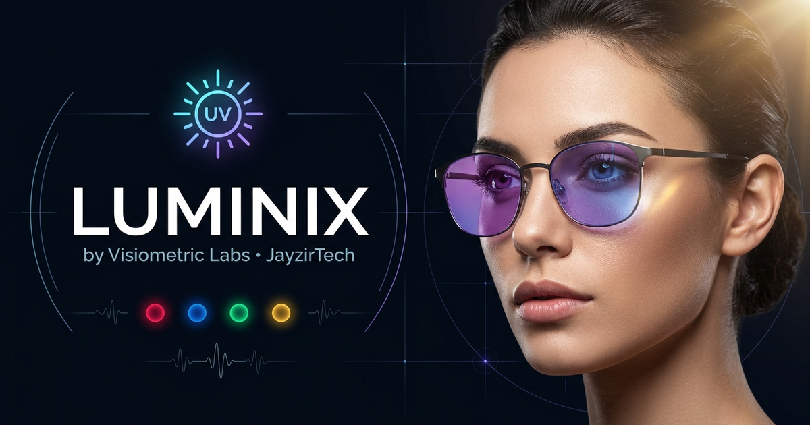

# Luminix™ by Visiometric Labs 🕶️✨

> **Interactive Clinical Simulator for Transitions® Photochromic Lenses and Real-Time 3D Virtual Try-On**  
> Engineered by **JayzirTech** for **Visiometric Labs**.

<p align="center">
  <a href="README.md"><strong>🇪🇸 Versión en Español</strong></a> • 
  <a href="README_EN.md"><strong>🇺🇸 English Version</strong></a>
</p>

<p align="center">
  <a href="https://visiometric-labs.github.io/transitions-simulator/"></a>
  <a href="https://visiometric-labs.github.io/transitions-simulator/"></a>
  
  
  
</p>

<p align="center">
  
</p>

---

## 🎯 Executive Overview

**Luminix** is a clinical-grade, first-person point-of-view (POV) optical simulation platform and real-time 3D virtual try-on, specifically designed for optical retail displays, optometric consulting rooms, and patient decision-making counters.

It empowers patients to visually experience the tangible contrast between unshielded vision (subjected to dazzling sunlight and harsh artificial glare) and the intelligent optical protection of **Transitions®** photochromic lenses (*Signature Gen S™*, *XTRActive® Polarized*, *Style Mirrors™*, and standard photochromic reference lenses).

---

## 🔬 Key Clinical & Technical Features

### 1. First-Person Point-of-View (POV) & Glare Comparison
- **Unshielded Vision (Naked Eyes)**: Multi-layer optical engine rendering genuine outdoor overexposure (50,000+ lux), corneal glare bloom (`mix-blend-mode: screen`), specular hotspots (`mix-blend-mode: color-dodge`), and volumetric sun haze.
- **Vision Through the Lens (Transitions®)**: Eliminates blinding glare, optimizes luminance to comfortable visual levels (0.70 to 0.86), restores color contrast and detail sharpness, and dynamically adapts kinetic tinting according to ambient UV radiation.
- **Physiological Gaze Kinematics**:
  - **Authentic Human Neck Physics**: Biomechanical neck rotation modeling Yaw (horizontal rotation ~±45°) and Pitch (vertical tilt ~+36° / -40°) with exponential framerate-independent damping (60 to 120+ FPS).
  - **Momentum Fling (Kinetic Inertia)**: Releasing drag input triggers realistic continuous sliding with progressive frictional deceleration.
  - **Direct Manipulation (No Virtual Joystick)**: 100% direct dragging via touch or mouse, ensuring a clean and modern retail interface.
  - **Looking Up**: Allows the patient to tilt gaze over the frame directly into unfiltered sunlight.
  - **Looking to Center**: Lowers gaze back through the photochromic lens, delivering instantaneous visual relief.
  - **Sub-Pixel Optical Alignment**: Outer environment (`SceneManager`) and filtered inner lens view (`GlassesPOV`) share identical SVG projection geometry (`viewBox="0 0 1920 1080"`, `width="2240" height="1250"`, synchronized pan `worldPanX = -gazeX * 120`, `worldPanY = -gazeY * 70`). Zero jump, zero latency, and seamless sub-pixel continuity when scenery elements cross the lens perimeter.
  - **Instant Recenter**: Dynamic floating button and double-tap / double-click to return to center neutral gaze.

### 2. Anatomical 3D WebGL Avatar (Three.js)
- **Full Skeletal Rig (`avatar.glb`)**: Complete bone hierarchy with facial articulators and physiological involuntary blink / smile blendshapes.
- **Autonomous Organic Behavior**: Natural lifelike state machine where forward-looking gaze is dominant (~70% of time), accompanied by subtle exploratory head turns and natural blinking every 3 to 5 seconds.
- **Strict Frame vs. Lens Separation**: The acetate frame (`Wolf3D_Glasses`) maintains an invariant satin matte black finish (`#181e28`) that **never changes color**, while dedicated optical meshes (`THREE.SkinnedMesh` with `MeshPhysicalMaterial`) modulate transmission, absorbance, authentic chromatic tint, and mirror reflections.

### 3. Clinical Preloader & Cinematic Crossfade
- **Pre-Caching & Memory Cloning**: Background assets and the 4.7 MB GLB avatar model are fully pre-cached in memory using `avatarModelCache` and `SkeletonUtils.clone`, rendering the female 3D avatar synchronously on frame 0.
- **Optical Dissolve Transition**: Upon completion, the landing screen and 3D avatar mount seamlessly behind the preloader, which gracefully dissolves using an 8px progressive blur, subtle scale expansion (`1.03`), and a 0.75-second smooth opacity fade-out (`cubic-bezier(0.16, 1, 0.3, 1)`).

### 4. Hero Landing Page & Subtle Tint Selector Bar
- **Clinical Technology Cards**: Institutional specification panels for *Transitions® Gen S™* kinetics and retail dispensing booth features.
- **Subtle Tint Selector Bar**: Floating pill toolbar calibrated to **103% width** and **zero vertical separation** beneath the avatar frame, enabling instant tint previews (Amethyst, Ruby, Sapphire, Emerald, Amber, Gray) before starting the simulation.

### 5. Clinical Retail Kiosk Mode
- **Inactivity Timer**: Automatic 5-minute inactivity timeout that smoothly returns to the landing screen and resets defaults (Sunny Park, Amethyst lens, Cat. 0 clear state).
- **Persistent Fullscreen**: The kiosk **preserves full-screen mode** upon automatic return, ensuring uninterrupted showroom operation.
- **URL Query Parameter Overrides for QA & Testing**:
  - `?timeout=2000`: Overrides the inactivity timeout to any millisecond value (e.g., 2 seconds for rapid testing).
  - `?autostart=true`: Automatically initiates simulation mode upon loading for hands-free demonstration testing.

### 6. Dual Clinical Testing Environments
- **Family Park (Sunny Outdoors)**: UV Index 9.2 with kinetic solar darkening in real time (~25 s).
- **Art Museum (Controlled Indoors)**: UV Index 0.1 with accelerated progressive fade-back to pristine optical clarity.
- **Synchronized 200ms Crossfade**: When toggling scenes, both the panoramic backdrop and the inner binocular lens projection transition simultaneously in exactly 200 ms.

### 7. Absolute Zero Sound Effects Policy
- 100% silent operation across all clicks, buttons, gestures, and scene switches, ensuring an unobtrusive, professional clinical setting.

---

## 👓 Available Ophthalmic Lens Families

| Family | Tints Available | Clinical Highlights |
| :--- | :--- | :--- |
| **Signature Gen S™** | Ruby, Sapphire, Amethyst, Emerald, Amber | Ultra-fast kinetics (25 s darkening), crystal-clear indoor clarity, 100% UVA/UVB blockage, and selective harmful blue-light filtration. |
| **XTRActive® Polarized** | Polarized Gray, Graphite Green | Superior outdoor sun protection, behind-the-windshield activation, and dynamic horizontal glare polarization. |
| **Style Mirrors™** | Flash Blue, Flash Silver, Flash Gold | Contemporary mirror coating that intensifies in direct sunlight and softens to an elegant sheen indoors. |
| **Standard Monofocal** | Basic Photochromic | Traditional photochromic baseline lens for clinical educational contrast against modern Gen S kinetics. |

---

## ⌨️ Controls & Keyboard Shortcuts

| Control / Shortcut | Action |
| :--- | :--- |
| **Drag (Touch / Mouse)** | First-person POV gaze navigation with human neck kinematics. |
| **Double-Tap / Double-Click** | Instant recentering of gaze to neutral forward point. |
| **Key `F` or `F11`** | Toggle Fullscreen mode. |
| **Key `Escape`** | Return to Welcome Landing Page from active simulation. |
| **Key `1`** | Switch to **Family Park** environment (outdoor UV 9.2). |
| **Key `2`** | Switch to **Art Museum** environment (indoor UV 0.1). |
| **Keys `WASD` / Arrow Keys** | Alternative keyboard-driven gaze steering. |

---

## 🎨 Visual Identity & Social Branding Assets

Luminix includes an optical-grade branding system with optimized social sharing and messaging assets:

| Asset | File Path | Dimensions | Primary Purpose |
| :--- | :--- | :--- | :--- |
| **Social Share Banner** | [`public/branding/og-card-whatsapp.png`](public/branding/og-card-whatsapp.png) | 1200 × 630 px | Rich preview card for WhatsApp, Open Graph, LinkedIn, Facebook, and Twitter Cards. |
| **Institutional Profile Picture** | [`public/branding/profile-picture.png`](public/branding/profile-picture.png) | 1024 × 1024 px | High-resolution square avatar featuring the Luminix optical reticle emblem. |
| **Vector Isotype (Favicon)** | [`public/branding/favicon.svg`](public/branding/favicon.svg) | SVG Vector | Browser favicon, HUD badges, and high-DPI user interface branding. |

---

## 🛠️ Technology Stack

- **Runtime & Bundler:** [Vite](https://vitejs.dev/) + Vanilla Modern JavaScript (ES Modules).
- **3D Graphics:** [Three.js](https://threejs.org/) (GLTFLoader, SkeletonUtils, SkinnedMesh, MeshPhysicalMaterial, ACESFilmicToneMapping).
- **Vector POV Engine:** Pan-optic binocular SVG with dual optical passes and dynamic `<clipPath>` masks.
- **Event Architecture:** Decoupled EventBus with global reactive state machine.
- **Kiosk Automation:** URL-configurable inactivity timer (`?timeout=`) with uninterrupted fullscreen retention.
- **CI/CD:** Automated GitHub Actions pipeline deploying to GitHub Pages upon pushing to `main`.

---

## 🚀 Installation & Local Development

```bash
# 1. Clone repository
git clone https://github.com/visiometric-labs/transitions-simulator.git
cd transitions-simulator

# 2. Install dependencies
npm install

# 3. Launch local development server
npm run dev

# 4. Build for production (validates bundle)
npm run build

# 5. Preview production build locally
npm run preview
```

---

## 🌿 Git Branching Strategy

- **`dev`**: Active development branch (all features, refactors, and styling adjustments take place here).
- **`main`**: Production-ready stable branch tied directly to GitHub Pages continuous deployment.

---

## 🏢 Credits & Legal

- **Organization:** Visiometric Labs
- **Software Architecture & Development:** JayzirTech
- **Reference Technologies:** Transitions Optical / EssilorLuxottica
- **Copyright:** © 2026 JayzirTech. All rights reserved.
